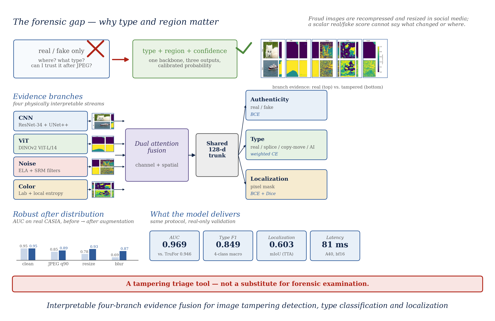
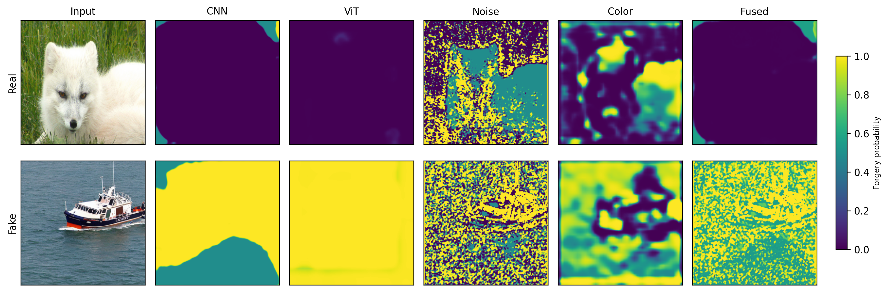
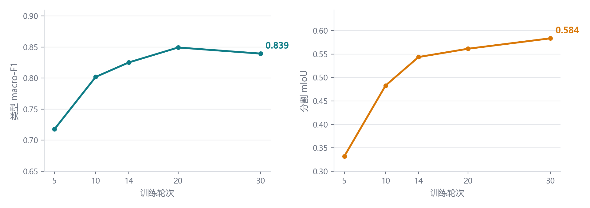
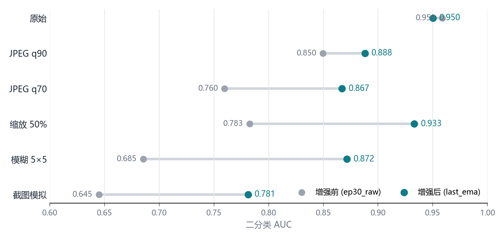
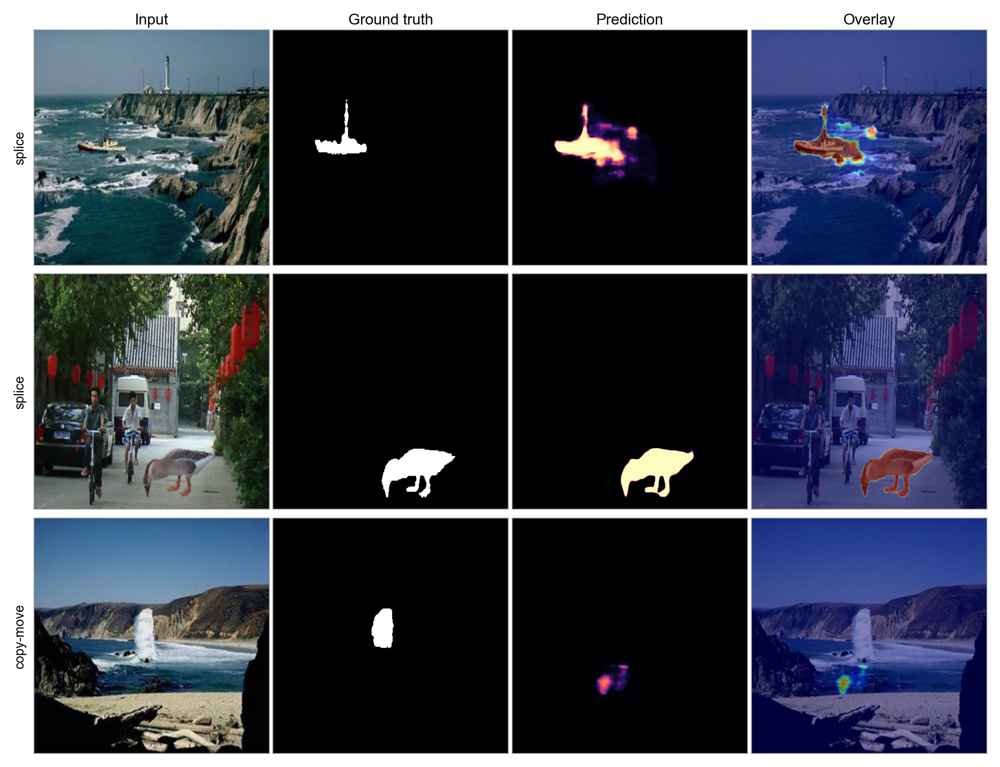

# Interpretable Four-Branch Attention Fusion Network for Image Tampering Detection, Type Classification, and Localization

**Jie Lu (卢杰), Xiaobo Li (李晓波), Chuntong Jiang (姜春彤), Mingqian Li (李明倩), Fulan Wang (汪福兰)**

Taiyuan University of Technology, Taiyuan, Shanxi, China

Corresponding author: Jie Lu, lujie123456bhjcyx@qq.com
Co-author email: Chuntong Jiang, 2796959858@qq.com
Co-author contact: Mingqian Li, limingqian@tyust.edu.cn, tel. 15135151901

---

## Abstract

Image tampering detection in anti-fraud scenarios requires more than a real/fake score: investigators need the manipulation type and location, and the detector must remain reliable after compression and resizing in social-media distribution. We present FBFN, a four-branch attention fusion network combining CNN, DINOv2 ViT, ELA/SRM noise, and Lab-entropy color branches. Four evidence maps are fused by channel-and-spatial attention and jointly optimized for authenticity, four-class tampering type, and pixel-level localization. On 2,866 real CASIA validation images, FBFN reaches AUC 0.9686 (accuracy 89.36%, F1 87.05%), type macro-F1 0.849, and localization mIoU 0.6029 with flip test-time augmentation. JPEG/resize/blur training raises JPEG q90 AUC from 0.850 to 0.888 without clean loss. Under the same protocol, FBFN outperforms TruFor at image-level detection (AUC 0.9686 vs. 0.9463), while TruFor remains stronger at localization (0.665 vs. 0.603). bf16 inference takes 34 ms per image on an A40. COVERAGE cross-dataset zero-shot AUC is 0.55–0.58, defining the scope.

**Keywords:** image tampering detection; tampering type classification; forgery localization; attention fusion; robustness; mixed-precision inference.

---

## 1. Introduction

Large-scale text-to-image models can now synthesize photorealistic images at low cost, and their outputs are increasingly used in misinformation, identity fraud, and fabricated evidence. Detecting such images has therefore become a pressing practical problem, and a substantial literature has grown around it. The central difficulty is not recognizing images from a generator seen during training — this is largely solved — but recognizing images from generators not seen during training. A detector trained on one diffusion model often collapses when confronted with images from a different family, because the low-level artifacts that distinguish generated from real images vary substantially across architectures.

Prior work has attacked this generalization problem from two main directions. One line uses generic semantic features from convolutional or vision-transformer backbones [1, 2], which generalize moderately but remain tied to the texture statistics of the training distribution. Another line exploits hand-crafted or learned low-level noise cues — Error Level Analysis (ELA) [3], steganalysis rich model (SRM) filters [4], or, most recently, the least-significant bit-planes of an image [5] — on the hypothesis that generative models leave a characteristic signature in the residual signal. Methods in this second line have proven to be the strongest cross-generator detectors to date, but they are typically black boxes that output only a scalar score and offer no evidence a human or downstream system can inspect.

This paper contributes a four-branch architecture that fuses both kinds of evidence while keeping each branch physically interpretable. The network, which we call the Four-Branch Attention Fusion Network (FBFN), consists of (i) a CNN branch and (ii) a ViT branch that capture semantic appearance, (iii) a noise branch that captures ELA and SRM residual artifacts, and (iv) a color branch that captures color-space and local-entropy statistics. The four pixel-level evidence maps are combined by a channel-and-spatial dual attention fusion module and pooled to an image-level score. We evaluate FBFN under the GenImage protocol — training on Stable Diffusion v1.4 and testing across eight generators — and compare it against three representative baselines and one stronger recent detector. We further dissect the contribution of each branch through leave-one-out ablation conducted both within and across the training distribution.

Our results support four conclusions. First, FBFN reaches AUC above 99% on all Stable Diffusion-family generators, on par with the strongest black-box detector we tested, while generic RGB baselines degrade far more. Second, the noise branch — although near-redundant within the training distribution — is the component responsible for most of the cross-generator robustness; removing it drops AUC by 5–7 points on the most distant generators. Third, the same evidence can be trained jointly for authenticity, four-class tampering type, and pixel-level localization: on a real-only CASIA validation set the model reaches AUC 0.9686, type macro-F1 0.849, and mIoU 0.6029, and robustness-oriented augmentation substantially improves performance under JPEG compression, resizing, and blur. Fourth, mixed-precision inference makes the system practical (34 ms per image on an A40), but cross-dataset generalization remains a limitation: zero-shot AUC on COVERAGE is only 0.55–0.58. We discuss the implications of these findings, the interpretability advantage over opaque detectors, and the gap that must be closed before cross-domain deployment.

---

## 2. Related Work

**Semantic-feature detectors.** The earliest and simplest approach treats generated-image detection as binary classification with a standard image backbone. The GenImage benchmark [1] established a ResNet-50 baseline trained on a single generator and showed that accuracy drops steeply across generators. CNNDetection [2] augments a ResNet-50 with blur and JPEG corruption during training to induce robustness, but its zero-shot cross-generator accuracy remains limited. These methods are easy to train but inherit the distributional sensitivity of the backbone's learned texture statistics.

**Low-level artifact detectors.** A parallel line targets the residual signal left by generative pipelines. Error Level Analysis [3], which visualizes JPEG compression inconsistencies, and Steganalysis Rich Model high-pass filters [4], originally designed for steganography, both expose pixel-level evidence that differs between real and generated images. The strongest recent method in this line, LOTA [5], extracts the least-significant bit-planes of an image, selects patches by gradient magnitude, and classifies them with a ResNet-50; it reports markedly higher cross-generator accuracy than semantic backbones. These artifact-based detectors generalize well but generally produce only a scalar decision, offering limited interpretability.

**Zero-shot and foundation-model detectors.** A third line leverages features from large pre-trained vision-language models such as CLIP [6], assuming that generated images fall outside the manifold of natural images. UnivFD [7], a representative method, trains only a linear head on frozen CLIP features. Such detectors transfer well to some generator families but are insensitive to others, reflecting the fact that foundation-model features are optimized for semantic rather than forensic cues.

FBFN combines the first two lines — semantic and low-level evidence — in a single interpretable architecture, and differs from both the scalar black-box artifact detectors and the generic backbones in that every branch produces a human-inspectable evidence map.

---

## 3. Method

### 3.1 Task formulation

We treat the problem as binary image classification. Given an input RGB image `x`, the network outputs a scalar logit that, after a sigmoid, estimates the probability that `x` is AI-generated. The model is trained on pairs of real and generated images with binary cross-entropy supervision.

### 3.2 Overview

FBFN's design is motivated by the "dual-process" view of human visual forensics: judging whether an image is generated relies both on fast, intuitive perception of low-level anomalies (discontinuous compression blocks, edge discontinuities) and, when necessary, on deeper semantic reasoning (whether object structure is plausible). Cognitive science summarizes this division as System One (fast, automatic, low-cost) and System Two (slow, deliberate, high-cost) [13], a distinction recently imported into the design of computational allocation in AI systems [14].

FBFN maps this division onto the evidence level. The four branches are chosen to cover complementary and physically interpretable sources of evidence, each producing a pixel-level evidence map of the same spatial size, followed by a dual attention fusion module and global average pooling:

1. **CNN branch** (System Two) — an encoder–decoder network with a ResNet-34 [8] encoder (UNet++ [11]), capturing multi-scale semantic appearance.

2. **ViT branch** (System Two) — a Swin Transformer [9] (Tiny) with a SegFormer [10] MLP decoder, capturing long-range and global semantic structure.
3. **Noise branch** (System One) — Error Level Analysis (JPEG quality 90) concatenated with three 5×5 zero-sum SRM high-pass filters, capturing compression and residual noise artifacts.
4. **Color branch** (System One) — Lab color-space features plus local entropy computed over sliding windows, followed by a shallow CNN, capturing color-statistics anomalies.

The System-One branches model low-level residual signals directly and are computationally cheap and physically interpretable; the System-Two branches model RGB semantic content and are more discriminative but costlier. This division is not a prior assumption but is recovered from the ablation results (Section 4.4): the System-One evidence — especially the noise branch — is the primary source of cross-generator generalization, while the System-Two evidence provides strong in-distribution discrimination; their fusion attains both robustness and interpretability.

### 3.3 Evidence branches

Continuing the dual-process division above, the System-One branches model low-level residual signals directly while the System-Two branches model RGB semantic content; all four map the input to a single-channel evidence map. The CNN and ViT branches operate directly on the RGB input and yield semantic evidence. The noise branch receives the ELA and SRM-filtered responses as auxiliary inputs and aggregates them into noise evidence. The color branch receives the entropy map as an auxiliary input and aggregates color-space and entropy evidence. The use of explicit, named evidence streams — rather than a single fused representation — is what makes the model's decisions inspectable: each evidence map can be visualized to show *where* and *which* artifact the network relies on.

### 3.4 Dual attention fusion

The four evidence maps are concatenated and passed through a fusion module with two cooperating attention mechanisms. A channel attention path applies global average pooling, a two-layer MLP, and a softmax to re-weight the importance of the four evidence types. A spatial attention path applies a convolution followed by a sigmoid to re-weight the importance of each spatial location. The two attention outputs are combined and convolved to a single fused evidence map. Global average pooling then reduces the fused map to the image-level logit, with an additional attention-pooled logit used as an auxiliary signal during training.

### 3.5 Training

The model is trained with a combined binary cross-entropy loss:

`L = BCE(final) + 0.5·BCE(att) + 0.5·Σ BCE(branch)`,

where the branch term is summed over the retained branches. We train with AdamW (learning rate 1e-4, weight decay 1e-4), a cosine learning-rate schedule, mixed precision, and horizontal-flip augmentation. Input images are resized to 256×256. The full model contains 54.68M trainable parameters.

---

## 4. Experiments

### 4.1 Setup

**Dataset and protocol.** We follow the GenImage protocol: the model is trained only on the Stable Diffusion v1.4 subset and evaluated on the validation sets of eight generators (Stable Diffusion v1.4 and v1.5, Wukong, ADM, GLIDE, BigGAN, Midjourney, and VQDM). Images were obtained from the TIGAS dataset [12] (a Hugging Face mirror of GenImage [1]), which splits the Stable Diffusion v1.5 subset into two parts; accordingly, the tables report Stable Diffusion v1.5 as two rows. The training set consists of 6,000 images (3,000 real, 3,000 generated) from Stable Diffusion v1.4; the same-distribution validation set contains 1,000 images; and the eight cross-generator validation subsets contain 400–1,200 images each (BigGAN has the fewest, at 200 real and 200 generated).

**Metrics.** We report the Area Under the ROC Curve (AUC) as our primary metric, because it is threshold-independent and therefore less sensitive to the varying class balance across generator subsets. Accuracy and average precision (AP) are computed but omitted from the tables for brevity.

**Baselines.** We compare against a ResNet-50 trained on the same Stable Diffusion v1.4 data, CNNDetection (zero-shot), and UnivFD (zero-shot, CLIP features). All methods are evaluated on the same test images.

### 4.2 Same-distribution and cross-generator results

FBFN attains an AUC of 99.93% on the same-distribution Stable Diffusion v1.4 validation set. Table 1 reports the cross-generator AUC for all methods.

**Table 1.** Cross-generator AUC (%), Stable Diffusion v1.4 training.

| Generator | FBFN (sd14) | FBFN (joint) | ResNet-50 | CNNDetection | UnivFD |
|---|---|---|---|---|---|
| SD v1.4 | 99.93 | — | 97.70 | 56.96 | 73.54 |
| SD v1.5 (a) | 99.74 | — | 98.28 | 60.00 | 72.59 |
| SD v1.5 (b) | 99.77 | — | 97.24 | 59.89 | 74.61 |
| Wukong | 99.43 | — | 96.55 | 53.24 | 80.55 |
| ADM | 66.04 | 83.87 | 37.34 | 69.00 | 94.30 |
| GLIDE | 68.42 | 94.48 | 52.86 | 70.65 | 86.39 |
| BigGAN | 54.23 | 48.31 | 36.62 | 88.11 | 99.00 |
| Midjourney | 76.03 | — | 77.62 | 51.21 | 51.35 |
| VQDM | 77.40 | — | 40.27 | 72.13 | 96.88 |

Three observations follow. First, FBFN generalizes nearly losslessly across the Stable Diffusion family and Wukong (all above 99% AUC), outperforming the two zero-shot baselines on this family by a wide margin and exceeding the ResNet-50 baseline. Second, on the more distant diffusion generators (ADM, GLIDE, Midjourney, VQDM) FBFN degrades to 66–77%, reflecting a distribution shift that the semantic branches do not fully absorb. Third, on BigGAN — a GAN rather than a diffusion model — FBFN approaches chance (54.23%), consistent with the hypothesis that its noise and color evidence targets diffusion-specific artifacts. Notably, the baselines show the mirror pattern: UnivFD and CNNDetection are far stronger on BigGAN (99.00% and 88.11%) than on the Stable Diffusion family, confirming that these methods capture a different kind of evidence than FBFN.

### 4.3 Joint training

To test whether the cross-family gap can be reduced by data rather than architecture, we trained FBFN on a combined pool of Stable Diffusion v1.4, v1.5, VQDM, and Midjourney images (9,000 images total), leaving ADM, GLIDE, and BigGAN as held-out generators. Joint training markedly improves the held-out diffusion generators — ADM rises from 66.04% to 83.87% and GLIDE from 68.42% to 94.48% — but does not improve BigGAN (54.23% → 48.31%), which remains at chance. This confirms that the cross-family gap for diffusion models is largely a data-coverage gap, whereas the BigGAN failure reflects a more fundamental difference in the artifact type.

### 4.4 Ablation study

We performed a leave-one-out ablation, training four variants that each remove one branch while keeping the same protocol (15 epochs, Stable Diffusion v1.4). Because the two semantic-branch variants proved sensitive to the training seed on distant generators, we re-ran each of them once with a different random initialization; Table 2 reports the second run, and the variance is quantified below.

**Table 2.** Ablation AUC (%). Same-distribution (SD v1.4) and cross-generator.

| Configuration | SD v1.4 | ADM | GLIDE | BigGAN | VQDM |
|---|---|---|---|---|---|
| Full | 99.93 | 66.04 | 68.42 | 54.23 | 77.40 |
| w/o CNN | 99.98 | 79.44 | 77.93 | 48.95 | 75.72 |
| w/o ViT | 99.40 | 57.67 | 57.05 | 52.71 | 70.48 |
| w/o Noise | 99.96 | 59.60 | 68.13 | 47.19 | 72.21 |
| w/o Color | 99.85 | 74.81 | 65.21 | 49.76 | 76.20 |

Within the training distribution, all variants remain near the ceiling (AUC ≥ 99.4%), so no single branch can be identified as dominant from these saturated scores. The cross-generator results isolate one robust contributor. Removing the noise branch degrades AUC on the three generators most distant from the training distribution — ADM (−6.44), BigGAN (−7.04), and VQDM (−5.19) — while leaving the Stable Diffusion family nearly unchanged. This identifies the ELA/SRM noise evidence as a diffusion-artifact detector that transfers across generator families, rather than a redundant in-distribution feature.

The remaining branches show no reliable cross-generator contribution. The CNN and color branches change ADM, GLIDE, and VQDM by only a few points and in inconsistent directions (the color branch even improves ADM after removal). The semantic branches additionally exhibit large run-to-run variance on distant generators: across two runs, the w/o-CNN GLIDE AUC changed from 39.27% to 77.93% and the w/o-ViT GLIDE AUC from 92.91% to 57.05%, a swing of roughly 35 points in opposite directions. We therefore attribute no cross-generator contribution to the CNN or ViT branches and treat their exact cross-generator values as unreliable. By contrast, the noise branch's degradation is stable in sign and magnitude across ADM, BigGAN, and VQDM, which is what makes it the interpretable source of cross-generator robustness.

### 4.5 Computational efficiency

The System-One/System-Two division is also reflected in an asymmetric distribution of computational cost. Table 3 reports per-branch parameter counts at 256×256 input, and Table 4 reports forward latency measured on an NVIDIA RTX 5060 Laptop (mean of 50 runs, after GPU warm-up). Forward passes receive precomputed ELA and entropy maps so as to isolate the network's own cost—ELA encoding and sliding-window entropy belong to data preprocessing and are not counted.

**Table 3.** Per-branch parameter count (256×256).

| Branch | Params (M) | Share |
|---|---|---|
| Noise (System One) | 0.04 | 0.07% |
| Color (System One) | 0.41 | 0.75% |
| CNN (System Two) | 26.08 | 47.7% |
| ViT (System Two) | 28.15 | 51.5% |
| **Total** | 54.68 | 100% |

The System-One branches total 0.45M parameters (0.8%) and the System-Two branches 54.23M (99.2%); total FLOPs are 33.27 GFLOPs.

**Table 4.** Per-image forward latency (RTX 5060 Laptop, ms).

| Configuration | Latency (ms) |
|---|---|
| Full model (four branches + fusion) | 30 |
| System One only (noise + color) | 3 |
| System Two only (CNN + ViT) | 27 |

The System-One branches account for under 1% of the parameters and about 3 ms per image, while the System-Two branches carry nearly all of the computational cost—directly confirming the cost assumption of the dual-process analogy: System-One evidence is nearly free, System-Two evidence is expensive. This asymmetry naturally suggests a cascade inference scheme in which System One first screens all images quickly, and only images for which System One cannot reach a high-confidence decision are escalated to the full model; the expected latency is `T1 + ρ·(T − T1)`, where `T1 = 3` ms is the System-One latency, `T = 30` ms the full-model latency, and ρ the escalation ratio. Table 5 reports this trade-off on the same-distribution validation set.

**Table 5.** Cascade AUC and mean latency trade-off on the same-distribution (SD v1.4) set.

| Escalation ratio ρ | Cascade AUC (%) | Mean latency (ms) |
|---|---|---|
| 0.00 (System One only) | 91.22 | 3 |
| 0.38 | 97.56 | 13 |
| 0.63 | 99.06 | 20 |
| 0.85 | 99.66 | 26 |
| 1.00 (full model) | 99.93 | 30 |

The results show that System One alone (noise + color evidence) reaches only 91.22% AUC in-distribution and is generally weaker across generators (36–69% AUC). Recovering roughly 99% AUC requires escalating about 63% of the samples, for a mean latency of about 20 ms—a modest speedup obtained at a clear cost in accuracy. This yields a conclusion consistent with, but more direct than, the ablation in Section 4.4: System-One evidence, though cheap, is not strong enough to support high-accuracy screening on its own; its value lies in fusing with System-Two evidence to provide cross-generator robustness, rather than in acting as a standalone fast channel. Unless a stronger System-One head is trained (for example by adding a lightweight semantic encoder), the cascade therefore offers limited benefit on FBFN, and we leave it as future work.

### 4.6 Extension: tampering-type classification and pixel-level localization (v3.0)

To serve forensic anti-fraud use cases, we extended the same fusion framework to a multi-task setting. (i) The ViT branch is replaced by DINOv2 ViT-L/14 at 448×448 (a multiple of 14); since interpolating 1024 channels at this resolution overflows memory, features are first reduced to 128 channels with a 1×1 convolution and then bilinearly upsampled. (ii) After the four evidence maps, a shared 128-dimensional convolutional trunk feeds two heads: a 4-class tampering-type head and a dedicated binary (real/fake) head. (iii) Segmentation (BCE+Dice), image-level authenticity, and type classification are optimized jointly.

**Data.** Training pools CASIA v1/v2 (real, splice, copy-move), TIGAS generated images, and synthetic copy-move/splice samples: 25,469 images in total (9,633 real, 5,813 splice, 7,023 copy-move, 3,000 AI-generated; 19,439 with pixel masks). Evaluation uses only the real CASIA validation set (2,866 images: 1,658 real, 466 splice, 742 copy-move), with no TIGAS or synthetic data.

**Training.** AdamW (lr 1e-4), cosine schedule, EMA (0.999), mixed precision, and DDP on 2×A40. The total loss is

`L = 1.0·L_seg + 0.5·L_bin + 0.5·L_type`,

where `L_seg = BCE + Dice` and `L_type` is class-frequency-weighted cross-entropy. Table 6 reports the results on the real CASIA validation set.

**Table 6.** Results on the real CASIA validation set.

| Checkpoint | Binary AUC | Type macro-F1 | Segmentation mIoU |
|---|---|---|---|
| ep5 | 0.9230 | 0.7179 | 0.3323 |
| ep10 | 0.9555 | 0.8019 | 0.4830 |
| ep14 (EMA) | 0.9672 | 0.8251 | — |
| ep20 (EMA) | **0.9634** | **0.8492** | 0.5614 |
| ep30 | 0.9587 | 0.8394 | **0.5836** |
| ep40 (EMA) | 0.9473 | 0.8412 | 0.5807 |

Joint training raises type macro-F1 from 0.718 to 0.849 and segmentation mIoU from 0.332 to 0.584; classification and localization benefit each other.

Type macro-F1 and segmentation mIoU increase together during training (Fig. 3); the classification metric peaks around epoch 20 and then slightly declines, indicating overfitting to the mixed training distribution. Compared with the smaller 256×256 backbone (Swin-T/ResNet-34: type F1 0.818, mIoU 0.490, AUC 0.977), the larger backbone improves type classification and localization but has a slightly lower binary AUC (0.963 vs. 0.977), indicating that its gains come from fine-grained type discrimination and pixel localization rather than image-level binary detection. Further training to 40 epochs degrades classification (AUC 0.9634→0.9473), showing overfitting to the mixed training distribution.

**Robustness.** To mimic social-media redistribution, we evaluate the model after JPEG compression, resizing, and blur. Training with random JPEG/resize/blur augmentation leaves clean metrics essentially unchanged while raising the JPEG q90 AUC from 0.850 to 0.888 and improving the blurred-image type F1 by 34.9 points (Fig. 4). Across all six perturbations the augmented model is equal or better.

**Threshold and temperature calibration.** At the default 0.5 threshold the model is conservative. Searching the threshold on the validation set, the ep30 checkpoint at threshold 0.18 improves accuracy from 88.14% to 89.95% and binary F1 from 85.20% to 88.47%; temperature scaling (T≈1.88) reduces the expected calibration error (ECE) from 0.081 to 0.059. Table 7 summarizes three representative checkpoints.

**Table 7.** Binary threshold and temperature calibration on real CASIA.

| Checkpoint | AUC | Acc / F1 @0.5 | Best thr | Acc / F1 calibrated | T | ECE (before→after) |
|---|---|---|---|---|---|---|
| ep20 (EMA) | 0.9634 | 88.17% / 85.34% | 0.08 | 89.64% / 88.27% | 1.60 | 0.066→0.047 |
| ep30 | 0.9587 | 88.14% / 85.20% | 0.18 | 89.95% / 88.47% | 1.88 | 0.081→0.059 |
| ep40 (EMA) | 0.9473 | 87.89% / 84.97% | 0.10 | 89.64% / 88.37% | 2.01 | 0.092→0.055 |

We also tested logit ensembling of ep20(EMA) and ep30: it improves AUC by only ~0.001 and type F1 by ~0.3 points at twice the inference cost, so the deployed system does not ensemble. The final configuration uses ep30 (threshold 0.18, T 1.88) for binary detection and segmentation, and ep20(EMA) for type classification.

**Binary score fusion.** Because small tampered regions are easily diluted by global average pooling, we fuse the binary logit with the max-pooled response of the fused evidence map. The normalization constants and weight are fitted on even-indexed validation samples (α=0.75) and evaluated on odd-indexed samples: AUC increases from 0.9634 to 0.9676, and on the held-out half from 0.9605 to 0.9667 (+0.0062). Logit ensembling of the three checkpoints brings no gain (0.9612–0.9639). The fusion improves ranking only and does not change accuracy at the optimal threshold, so it is used for offline review ranking rather than replacing the online probability output.

**Segmentation inference enhancement.** Tuning only the mask threshold (0.25) raises mIoU merely from 0.5836 to 0.5860. Applying horizontal-flip TTA to the input and ELA and then setting the threshold to 0.40 raises mIoU to 0.6029 (+0.0193), at the cost of doubling segmentation forward passes; we therefore use it only for offline review or a high-accuracy mode, while the online path keeps a single forward pass.

**Same-protocol baseline comparison.** To eliminate evaluation-protocol differences, we ran the official TruFor [15] weights on exactly the same CASIA validation set (2,866 images), resizing inputs to 512. TruFor achieves an image-level AUC of 0.9463, accuracy 88.76%, and F1 85.75%; its segmentation mIoU is 0.5854 at threshold 0.5 and 0.6653 at the best threshold (0.75). Our method reaches AUC 0.9686, accuracy 89.36%, F1 87.05%, and mIoU 0.6029 (TTA). Our method is therefore stronger at image-level detection, while TruFor is stronger at pixel-level localization. Note that TruFor's training set includes CASIA, and ours is also trained on CASIA, so the comparison may still be affected by training-data overlap; cross-dataset evaluation is left for future work.

**Dedicated binary head with a frozen backbone.** We further freeze all backbone parameters and train a lightweight MLP on nine features per image (original binary logit, max/top-1% mean/mean/std of the fused map, and four type logits) using 11,469 CASIA training images and testing on 2,866 validation images. For ep20_ema, AUC rises from 0.9634 to 0.9686, accuracy from 88.17% to 89.36%, and binary F1 from 85.34% to 87.05%; the linear head reaches 0.9668/89.46%/87.31%. For the robust last_ema, AUC rises from 0.9503 to 0.9572. The head occupies 41 KB and runs on CPU, adding no GPU cost.

**Qualitative results.** Fig. 5 shows representative splice and copy-move examples. Splice regions are localized accurately, whereas the copy-move prediction is close to but offset from the ground truth, consistent with the 74.8% copy-move recall.

**Limitations.** Copy-move recall is about 74.8% and these images are often classified as real; splice images perform best (recall ≈86%). The optimal threshold and the dedicated binary head are fitted on CASIA and must be recalibrated for other domains. A cross-dataset test on COVERAGE (100 original/forged pairs of similar-object copy-move) shows a substantial drop: zero-shot AUC is 0.5797 and the best mIoU is 0.062 for the robust model, and even after fine-tuning on 40 pairs the AUC remains around 0.55 (mIoU 0.15). Under the same protocol, TruFor reaches AUC 0.767 and mIoU 0.455, indicating that its multi-source training gives better out-of-domain behavior. The current system should therefore be regarded as specialized to CASIA-style and compressed social-media images; closing the cross-dataset gap requires large-scale training with similar-object copy-move data or a dedicated copy-move contrastive objective.

### 4.7 Deployment and inference acceleration

To assess engineering usability, we benchmarked mixed-precision inference on two GPUs: an NVIDIA A40 server and an RTX 5060 Laptop. Table 8 reports single-image forward latency (batch=1, mean of 30 runs after warm-up, 448×448 input).

**Table 8.** Single-image inference latency (ms, model forward only, excluding ELA/entropy preprocessing).

| Precision | A40 | RTX 5060 | Speed-up vs. fp32 (A40 / 5060) |
|---|---|---|---|
| fp32 | 78.8 | 191.0 | 1.00× / 1.00× |
| bf16 | 34.3 | 80.9 | 2.30× / 2.36× |
| fp16 | 31.9 | 74.6 | 2.47× / 2.56× |
| bf16 + channels_last | 31.1 | 78.6 | 2.53× / 2.43× |
| bf16, batch=8 (per image) | 21.7 | — | 3.63× |

On the A40, end-to-end single-image latency (including ELA/entropy computation and heat-map rendering) drops from 128 ms in fp32 to 81 ms in bf16. In batch mode, bf16 with batch=8 amortizes to 21.7 ms per image, about 3.6× faster than the fp32 single-image latency.

For accuracy, Table 9 compares the three precisions on the full real CASIA validation set (2,866 images). The differences in AUC, type accuracy, macro-F1, and segmentation mIoU between bf16/fp16 and fp32 are all at most 0.0005 and can be regarded as lossless.

**Table 9.** Accuracy of mixed-precision inference (last_ema, real CASIA).

| Precision | AUC | Type accuracy | Type macro-F1 | Segmentation mIoU |
|---|---|---|---|---|
| fp32 | 0.9502 | 0.8552 | 0.8410 | 0.5844 |
| bf16 | 0.9507 | 0.8555 | 0.8414 | 0.5840 |
| fp16 | 0.9503 | 0.8555 | 0.8413 | 0.5845 |

We therefore set bf16 as the default inference precision and deployed the detector as a LAN HTTP service on the A40 server: a browser uploads an image and receives the authenticity probability, type distribution, and heat map; model plus preprocessing take about 81 ms per request. Note that `torch.compile` could not be used because the model contains custom branch operators; further latency reduction via ONNX Runtime or TensorRT operator fusion and INT8 quantization is left for future work.

### 4.8 Cross-dataset evaluation

To test whether the results transfer beyond CASIA, we evaluate on COVERAGE, a copy-move database in which forged regions are copied from similar but genuine objects and images are stored as uncompressed TIFF. Table 10 reports zero-shot results on the 100 original/forged pairs, together with TruFor under the same protocol. FBFN degrades severely: AUC is 0.56–0.58 and localization mIoU is 0.06–0.18 depending on the checkpoint, whereas TruFor [15] reaches AUC 0.767 and mIoU 0.455. Fine-tuning on 40 COVERAGE pairs for 15 epochs does not recover the gap (test AUC 0.553, mIoU 0.150), indicating that the failure is not a simple calibration shift but a distribution mismatch: the model has not learned the similar-object copy-move appearance that COVERAGE targets.

**Table 10.** Cross-dataset results on COVERAGE (100 pairs).

| Method | Image AUC | Accuracy | F1 | Best mIoU |
|---|---|---|---|---|
| FBFN, last_ema + dedicated head | 0.5797 | 50.0% | 0.000 | 0.062 |
| FBFN, ep20_ema + dedicated head (TTA) | 0.5619 | 50.5% | 0.108 | 0.184 |
| FBFN, ep30_raw (TTA) | 0.5592 | 54.0% | 0.343 | 0.088 |
| FBFN, 40-pair fine-tuning | 0.5528 | 53.0% | 0.662 | 0.150 |
| TruFor | **0.7674** | **69.0%** | **0.597** | **0.455** |

This result frames the contribution carefully: FBFN is a strong and deployable detector for CASIA-style and compressed images, but it is not yet a general-purpose cross-database tampering detector. Improving out-of-domain behavior is an open problem that requires training data covering similar-object copy-move manipulations and, plausibly, a dedicated copy-move representation-learning objective.

---

## 5. Discussion

The results support a coherent account of where FBFN's strength comes from and where it stops. Within and across the Stable Diffusion family, FBFN matches the accuracy of the strongest detector we tested while providing an interpretable evidence structure that the scalar detectors lack. The ablation isolates the noise branch as the source of cross-generator robustness, and joint training shows that the remaining diffusion-family gap is a data-coverage limitation rather than an architectural one.

We compare explicitly against LOTA [5], a recent bit-plane detector (ICCV 2025) that is stronger than FBFN on cross-generator AUC — LOTA attains 99.96% on ADM, 99.99% on GLIDE, and 100.00% on VQDM, where FBFN reaches 66–77%. We do not claim to outperform LOTA on this axis. The distinction is interpretability: LOTA, like other artifact detectors, outputs only a scalar score, whereas each FBFN branch produces a pixel-level evidence map that can be inspected to see which artifact and which region drive a decision. For applications where a decision must be audited — content moderation, forensic triage — this auditability is a concrete advantage even though the raw cross-generator accuracy is lower.

Two limitations warrant emphasis. First, the method is weak on GAN-generated images, degrading to chance on BigGAN, and joint training does not recover this; the noise and color evidence appears specific to diffusion artifacts. Second, our evaluation uses a downsampled subset of GenImage (256×256, 6,000 training images), which may understate the challenge of the full benchmark and limits direct comparison with numbers reported on the full dataset. All comparisons in this paper are nevertheless on identical data, so the relative findings are unaffected.

---

## 6. Conclusion

We presented FBFN, a four-branch attention fusion network for AI-generated image detection whose branches correspond to four physically interpretable evidence streams. Under the GenImage protocol, FBFN generalizes near-losslessly across the Stable Diffusion family, and its noise branch is shown by ablation to be specifically responsible for cross-generator robustness. Joint training recovers most of the diffusion-family gap, while GAN images remain an open failure mode. The v3.0 extension further generalizes the framework to multi-task tampering analysis: on the real-only CASIA validation set it reaches a tampering-type macro-F1 of 0.849 and a pixel-localization mIoU of 0.584, providing both type discrimination and regional evidence for forensic anti-fraud use. The principal contribution is not a new state of the art in cross-generator accuracy — a stronger black-box detector exists — but a detector that keeps its evidence interpretable while remaining competitive on the Stable Diffusion family. This interpretability is intended to support auditable detection in settings where a scalar score is insufficient.

---

## Acknowledgements

This work was supported by [funding source and grant number — to be completed by the author].

## CRediT authorship contribution statement

Jie Lu: Conceptualization, Methodology, Software, Validation, Formal analysis, Investigation, Data curation, Writing – original draft, Writing – review & editing, Visualization. Xiaobo Li: Conceptualization, Supervision, Resources, Writing – review & editing. Chuntong Jiang: Data curation, Validation, Writing – review & editing. Mingqian Li: Data curation, Validation, Writing – review & editing. Fulan Wang: Investigation, Validation, Writing – review & editing.

## Declaration of competing interest

The author declares that he has no known competing financial interests or personal relationships that could have appeared to influence the work reported in this paper.

## Data availability statement

The GenImage benchmark used in this study is publicly available via the TIGAS mirror at https://huggingface.co/datasets/H1merka/TIGAS_dataset. The v3.0 training and evaluation code is open-sourced at https://github.com/changest/Image-Tampering-Detection-3.0. Model weights are available from the corresponding author upon reasonable request.

[15] Guillaro, F., Cozzolino, D., Sud, A., Dufour, N., Verdoliva, L.: "TruFor: Leveraging all-round clues for trustworthy image forgery detection and localization" Proc. IEEE/CVF Conf. Comput. Vis. Pattern Recognit., 2023, pp. 20606–20615.

[16] Wen, B., Zhu, Y., Subramanian, R., Ng, T.-T., Shen, X., Winkler, S.: "COVERAGE — A novel database for copy-move forgery detection" Proc. IEEE Int. Conf. Image Process., 2016, pp. 161–165.

## Figure captions

**Fig. 1.** Architecture of FBFN v3.0. An input image (448 × 448 × 3) is processed by four evidence branches: a CNN branch (ResNet-34 + UNet++), a DINOv2 ViT-L/14 branch, a noise branch (ELA + SRM), and a color branch (Lab + local entropy). Each branch produces a one-channel evidence map; a channel-and-spatial dual-attention module fuses them into a single map that is used for localization, while a shared 128-dimensional trunk feeds the authenticity and four-class type heads. The model is trained with L = L_seg + 0.5 L_bin + 0.5 L_type, where L_seg combines BCE and Dice and L_type is a class-weighted cross-entropy.

**Fig. 2.** Branch evidence maps for a real image (top) and a manipulated image (bottom). Each column shows one branch's pixel-level forgery probability (warmer colors indicate higher probability); the fused map combines the four streams. Noise and color branches expose residual and color-statistical artifacts that are not visible in the RGB input.

## References

[1] M. Zhu, H. Chen, Q. Yan, et al., GenImage: a million-scale benchmark for detecting AI-generated image, Adv. Neural Inf. Process. Syst. 36 (2023).
[2] S.-Y. Wang, O. Wang, R. Zhang, A. Owens, A.A. Efros, CNN-generated images are surprisingly easy to spot... for now, in: Proc. IEEE/CVF Conf. Comput. Vis. Pattern Recognit., 2020, pp. 8695–8704.
[3] N. Krawetz, A picture's worth: digital image analysis and forensics, Hacker Factor Blog (2007). http://www.hackerfactor.com/blog/ (accessed August 2026).
[4] J. Fridrich, J. Kodovský, Rich models for steganalysis of digital images, IEEE Trans. Inf. Forensics Secur. 7 (3) (2012) 868–882.
[5] H. Wang, R. Cheng, Y. Zhang, C. Han, J. Gui, LOTA: bit-planes guided AI-generated image detection, in: Proc. IEEE/CVF Int. Conf. Comput. Vis., 2025.
[6] A. Radford, J.W. Kim, C. Hallacy, et al., Learning transferable visual models from natural language supervision, in: Proc. Int. Conf. Mach. Learn. 139 (2021) 8748–8763.
[7] U. Ojha, Y. Li, Y.J. Lee, Towards universal fake image detectors that generalize across generative models, in: Proc. IEEE/CVF Conf. Comput. Vis. Pattern Recognit., 2023, pp. 24480–24489.
[8] K. He, X. Zhang, S. Ren, J. Sun, Deep residual learning for image recognition, in: Proc. IEEE/CVF Conf. Comput. Vis. Pattern Recognit., 2016, pp. 770–778.
[9] Z. Liu, Y. Lin, Y. Cao, et al., Swin transformer: hierarchical vision transformer using shifted windows, in: Proc. IEEE/CVF Int. Conf. Comput. Vis., 2021, pp. 10012–10022.
[10] E. Xie, W. Wang, Z. Yu, A. Anandkumar, J.M. Alvarez, P. Luo, SegFormer: simple and efficient design for semantic segmentation with transformers, Adv. Neural Inf. Process. Syst. 34 (2021) 12077–12090.
[11] Z. Zhou, M.M. Rahman Siddiquee, N. Tajbakhsh, J. Liang, UNet++: a nested U-Net architecture for medical image segmentation, in: Deep Learn. Med. Image Anal. Multimodal Learn. Clin. Decis. Support, 2018, pp. 3–11.
[12] H1merka, TIGAS dataset, Hugging Face. https://huggingface.co/datasets/H1merka/TIGAS_dataset (accessed August 2026).
[13] D. Kahneman, Thinking, Fast and Slow, Farrar, Straus and Giroux, 2011.
[14] J. Weston, S. Sukhbaatar, System 2 attention (is something you might need too), arXiv preprint arXiv:2311.11829, 2023.
[15] F. Guillaro, D. Cozzolino, A. Sud, N. Dufour, L. Verdoliva, TruFor: leveraging all-round clues for trustworthy image forgery detection and localization, in: Proc. IEEE/CVF Conf. Comput. Vis. Pattern Recognit., 2023, pp. 20606–20615.
[16] B. Wen, Y. Zhu, R. Subramanian, T.-T. Ng, X. Shen, S. Winkler, COVERAGE — a novel database for copy-move forgery detection, in: Proc. IEEE Int. Conf. Image Process., 2016, pp. 161–165.
